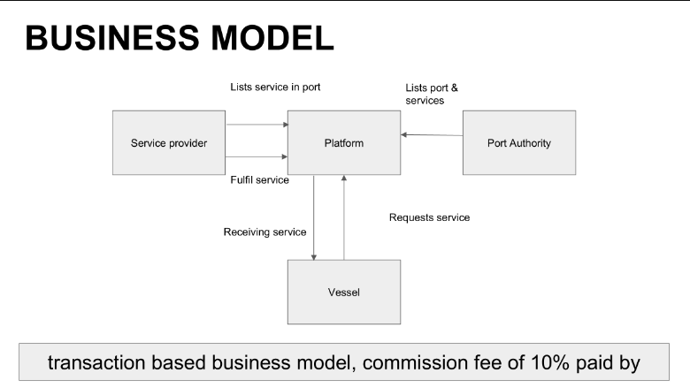
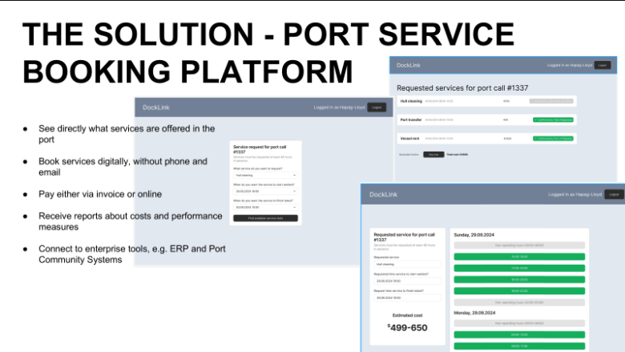
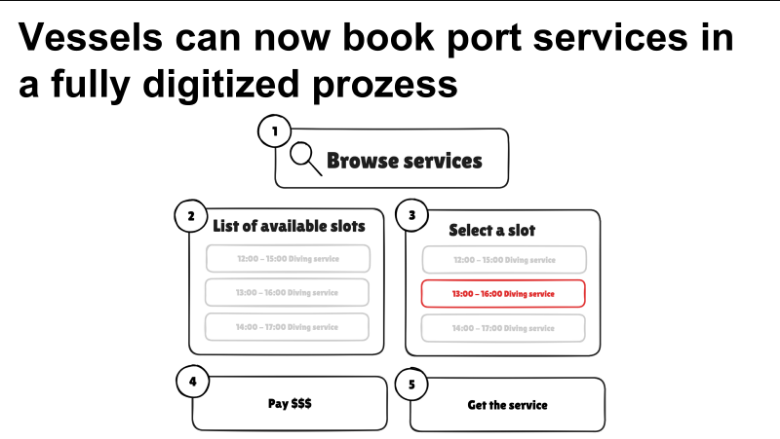

# CaptainIncognito

Ph.D. student, enthusiastic. I build / design / write system and I'm learning python.

[Projects](#projects) · [About](#about) · [Contact](#contact)

## Projects

A few things I've made. Each one follows the same layout so they're easy to compare.

### AI-Augmented Navigation Tools (Research Project)

The rapid deployment of offshore wind farms has created structurally constrained maritime corridors where collision risk is elevated. ECDIS remains a primary navigational decision-support tool, but its use near offshore wind farms is limited by radar degradation caused by clutter and shadowing, weak integration of probabilistic risk models with real-time sensor fusion, and opaque alerts that can hinder operator trust. Standard systems also do not learn from historical traffic patterns to predict vessel intentions in constrained waterways. Artificial intelligence could help address these limitations through improved sensor fusion, risk modelling, alert explanation, and traffic-pattern analysis.

- **Type:** Personal project
- **Tools:** MATLAB, GitHub
- **Date:** TODO
- **Status:** In progress

### Customer-Centric App for Port Services

A group project for managing port-service requests, availability, vessel reservations, operational documentation, and invoicing.

1. A customer initiates a service request by email inquiry.
2. A sales representative checks the availability of the services and responds with an application form.
3. The customer completes the form and submits it with advance payment confirmation.
4. The sales representative notifies the relevant internal department to reserve the necessary vessel.
5. The customer coordinates directly with the vessel crew in case of changes, although the port authority does not want that.
6. The crew fills in documents about the time spent and fuel used.
7. The sales representative consolidates the data into the internal document management system.
8. Accounting generates an invoice based on the compiled documentation.

#### Demo Version

- **Type:** Group project
- **Tools:** [Supabase](https://supabase.com/)
- **Date:** 29/09/2024
- **Status:** Finished

## About

I have Master’s degree in Shipping & Port Engineering (Seaport Management) at Klaipėda University, combining academic excellence with hands-on experience in navigation as a cadet in private compan[...]

I hold a Bachelor’s in Marine Navigation Engineering from the Azerbaijan State Marine Academy and bring 2 years of sailing experience. My work and study across multiple countries have strengthened m[...]

Beyond the maritime field, I am committed to youth empowerment, having dedicated 2 years to volunteering, leadership development, and mentorship—skills that translate into effective teamwork, stakeh[...]

## Skills

Maritime Safety · Maritime Operations · International Shipping · AutoCAD · Radar plotting · GMDSS · ECDIS

## Contact

The best way to reach me is by email.

- [orkhanmirzayev222@gmail.com](mailto:orkhanmirzayev222@gmail.com)
- [GitHub](https://github.com/Orhanmirza03)
- [Youtube](https://youtube.com/@orhannmirza)

© 2026 CaptainIncognito
